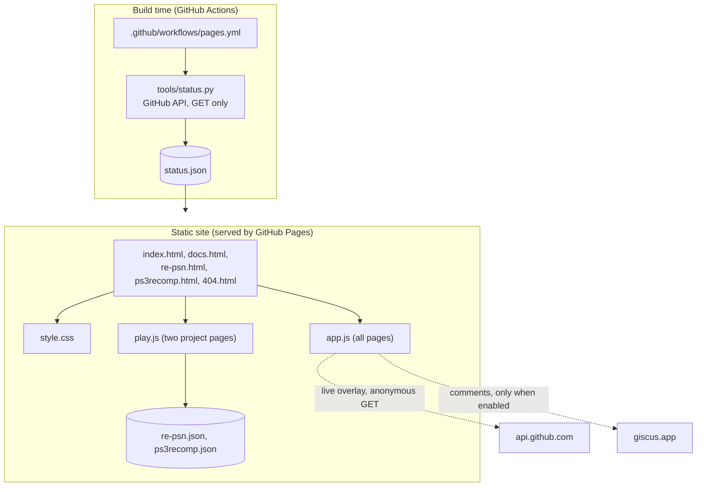
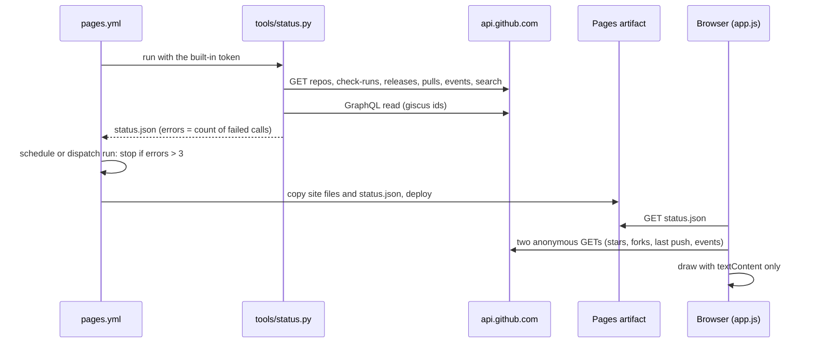
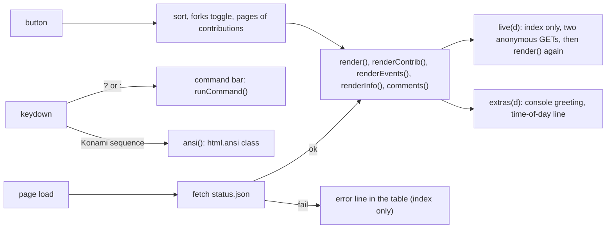

# Code map

How the site is built, where each part lives and how to change it safely. The diagrams are Mermaid and render on GitHub. Facts here were read from the code at `main` on 2026-11-23.

## Layers

| Layer | Files | Job |
|---|---|---|
| Automation | `.github/workflows/pages.yml` | the only workflow: build, guard, snapshot, deploy |
| Data build | `tools/status.py` | reads public repositories, CI, releases, pull requests, events; writes `status.json` |
| Pages | `*.html` | static markup, one `<script>` per file, no inline script |
| Behaviour | `app.js`, `play.js` | draws the tables, live numbers, comments, effects; plays the scenarios |
| Look | `style.css` | palette tokens on `:root`, page rules, the project-page diagrams, terminal extras |
| Scenario data | `re-psn.json`, `ps3recomp.json` | steps, captions and drawing paths for the diagrams |
| Repository | `README.md`, `.github/ISSUE_TEMPLATE/*`, `.github/FUNDING.yml`, `assets/*`, `LICENSE` | description, forms, images |

## Entry points

| Entry | What starts there |
|---|---|
| Push to `main`, `workflow_dispatch`, schedule `17 * * * *` | `pages.yml` job `deploy` |
| `python3 tools/status.py USER OUTFILE [OWNER/REPO]` | writes `OUTFILE` (the workflow passes `status.json`); `OWNER/REPO` is only for the giscus ids |
| `index.html` loads `app.js` | table, contributions, events, comments, live overlay, effects, command line |
| `docs.html` loads `app.js` | header, top button, extras only |
| `re-psn.html`, `ps3recomp.html` load `play.js` then `app.js`; `<body data-scenarios="NAME.json">` | player for that JSON file |
| `404.html` | message built from the path; loads `/me/style.css` |

## Data flow

`status.json` fields (written by `main()` in `tools/status.py`): `generated`, `user`, `repos[]` (`name`, `full_name`, `url`, `fork`, `description`, `stars`, `forks`, `pushed_at`, `branch`, `ci{state,total,summary}`, `release{tag,date,pre,url}`, `open_prs`, `open_issues`), `events[]` (`at`, `what`, `repo`), `contrib[]` (`repo`, `number`, `title`, `pr`, `state`, `updated`, `url`), `giscus` (or null), `errors`, `build.sha`. A failed call is stored as unknown (`null` or `"unknown"`), never as zero.

Scenario files: `{ "scenarios": [ { id, title, summary, steps: [ { from, to, message, caption, kind, path, lost } ] } ] }`. `path` is a list of `[x, y]` points in the diagram's coordinates; `lost` stops the packet part-way.

## Control flow in the browser

`app.js` is one IIFE and runs on every page, so each block first checks that its elements exist (`rowsEl` is null on the project pages; `live()` returns at once without it). Section order in the file: helpers (`time`, `ago`, `el`, `link`, `num`), table and lists, comments, button handlers, scroll and top button, effects (bounce, confetti, banner ads, fall and restore), live overlay and mood line, terminal extras.

`play.js` has a pure state machine (`create`, `play`, `pause`, `forward`, `back`, `jump`, `tick`) separate from the DOM builders (`mount` and the helpers), so the timing can be reasoned about without a browser. Nothing is exported: the file is one IIFE that fetches the scenario file named on `<body>` and, if that fails, leaves the static page as it is.

## Rules the code keeps

- Text goes in with `textContent` and DOM calls, never HTML strings.
- Links go to `https://github.com/`, the fixed Ko-fi link and the Discord invite. Requests go only to `api.github.com` and (when comments are on) `giscus.app`.
- No cookies, no browser storage, no external fonts.
- Actions in the workflow are pinned by commit; every write permission has a comment saying why.
- A scheduled or manual run that has more than 3 failed API calls fails on purpose, so the previous deployment stays.

## Build and test map

There is no build step and no committed test suite. Checks that are run by hand before a change:

| Check | How | Covers |
|---|---|---|
| Workflow syntax | `actionlint` | `pages.yml` |
| Script syntax | `node --check app.js play.js`; `python3 -m py_compile tools/status.py` | parse errors |
| Data | `python3 tools/status.py USER /tmp/status.json` (set `GITHUB_TOKEN` for a higher limit) | the API calls and the file shape |
| Local site | copy the files and a current `status.json` into one folder, `python3 -m http.server`, open `index.html` | rendering and live overlay |
| Browser behaviour | a headless Chromium driven over the DevTools protocol: no console errors on all four pages, sorting, Escape, command bar, scenario player, 420 px and 1100 px widths | the interactive parts |
| After a merge | the `pages` run is green, and `status.json` `build.sha` equals `main` | the deployment |

## Where to change what

| Want to | Edit |
|---|---|
| add a column or field | `tools/status.py` `main()`, then `render()` and the `<thead>` in `index.html` |
| change how often it runs | `cron` in `pages.yml` (GitHub may delay it) |
| add a project page | new `.html` and `.json`, add both to the `cp` line of the step "Collect the site", link it from `index.html` |
| change colours | the tokens at the top of `style.css`; `html.ansi` has its own set |
| add a command-line command | the `COMMANDS` object in `app.js` and its help text |
| add a scenario | an entry in the JSON file; the player and the static list pick it up |

## Not mapped

- The rules in `style.css` are grouped by comment headers only; they are not listed rule by rule here.
- The effects code (confetti, banner ads, fall and restore) is described by its place in the file, not step by step.
- The behaviour of the schedule after 60 days without repository activity is not confirmed by GitHub.
